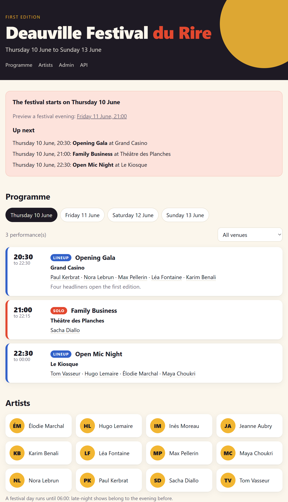

# Deauville Festival du Rire

> *Rendu pour le cours de Programmation Orientée Objet*

Python · FastAPI · pytest · uv

Application Python pour gérer les artistes, spectacles et inscriptions aux
ateliers du festival (10–13 juin 2027), depuis un terminal ou un site web.

Réalisé à partir du [projet de départ `deauville-starter`](https://github.com/nathanvid/deauville-starter).



## Installation et utilisation

Prérequis : Python 3.14+ et [uv](https://docs.astral.sh/uv/).

```powershell
git clone https://github.com/kinsey-w/deauville-festival.git
cd deauville-festival
uv sync
```

**Terminal** — résumé, programme et aide :

```powershell
uv run python -m deauville
uv run python -m deauville programme 2027-06-11
uv run python -m deauville --help
```

**Site et administration** :

```powershell
uv run python -m deauville serve
```

Serveur lancé : [site](http://127.0.0.1:8000/),
[administration](http://127.0.0.1:8000/admin/),
[documentation API](http://127.0.0.1:8000/docs).

Les données sont dans `data/festival.json`. Pour un autre fichier existant :
`uv run python -m deauville --data chemin/festival.json serve`.
Les commandes utilisent `python -m` pour éviter les lanceurs bloqués par Windows.

## Tests et vérifications

```powershell
uv run python -m pytest
uv run ruff format .
uv run ruff check .
uv build
```

## Structure et choix

Le code est dans `src/deauville/` :

| Fichier | Rôle |
| --- | --- |
| `models.py` | `Venue`, `Artist`, classe abstraite `Performance` et ses variantes `SoloShow`, `Lineup`, `Workshop`. |
| `festival.py` | `Festival` rassemble les objets, filtre le programme et vérifie les conflits. |
| `service.py` | `FestivalService` charge, applique une modification validée et sauvegarde. |
| `storage.py` | `FestivalStorage` définit l'interface ; `JsonStorage` et `MemoryStorage` l'implémentent. |
| `errors.py` | Exceptions métier et messages expliquant les erreurs. |
| `cli.py`, `__main__.py` | Commandes et lancement depuis le terminal. |
| `api.py` | Routes FastAPI, validation des requêtes avec Pydantic et réponses HTTP. |
| `web/`, `data/` | Site public, administration et données initiales intégrées au paquet. |

À la racine : `tests/` contient les tests pytest, `API.md` décrit le contrat HTTP,
`pyproject.toml` et `uv.lock` définissent le paquet et ses dépendances.
`main.py` et `api.py` conservent les anciens points d'entrée ;
`docs/PROJECT_BRIEF.md` conserve le sujet.

**Modèle et règles.** L'héritage partage les comportements communs des spectacles. Les règles propres
à chaque type sont dans sa classe ; les règles entre spectacles sont dans
`Festival`. Le terminal et l'API utilisent donc les mêmes règles.
Les objets sont immuables pour éviter de contourner ces vérifications.

**Erreurs.** Les exceptions distinguent une référence inconnue (`NotFoundError`, HTTP 404),
un conflit ou doublon (`ConflictError`, 409), une valeur invalide
(`InvalidValueError`, 422) et un problème de stockage (`StorageError`, 500).
Leur message précise la cause.

**Stockage.** Le stockage est séparé du modèle : passer à une base de données demanderait
une nouvelle implémentation de `FestivalStorage` et sa sélection au lancement,
sans changer les règles métier.

## État et limites

**E00–E13 réalisés** : terminal, trois types de spectacles, site, administration,
contrat HTTP, tests et paquet installable.

- SQLite : extension facultative non implémentée.
- Ajout depuis le terminal : solos uniquement ; l'administration gère les trois types.
- Écritures simultanées depuis plusieurs processus ou un éditeur externe du JSON : non gérées.
